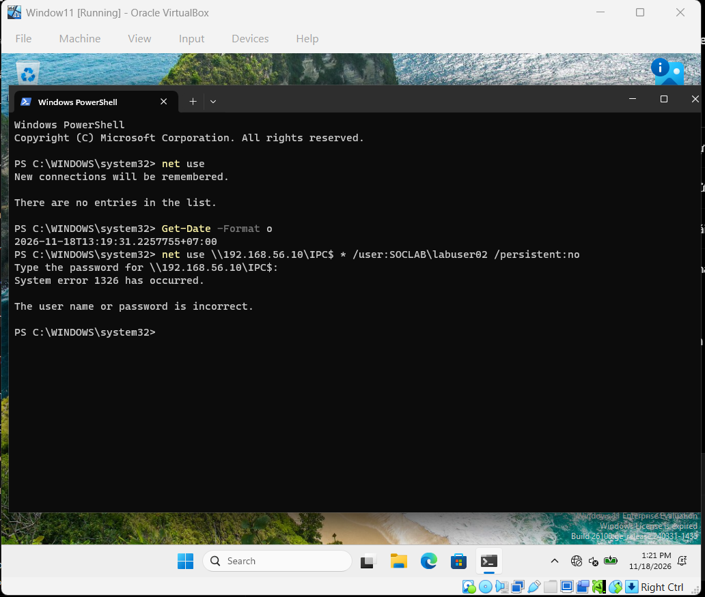
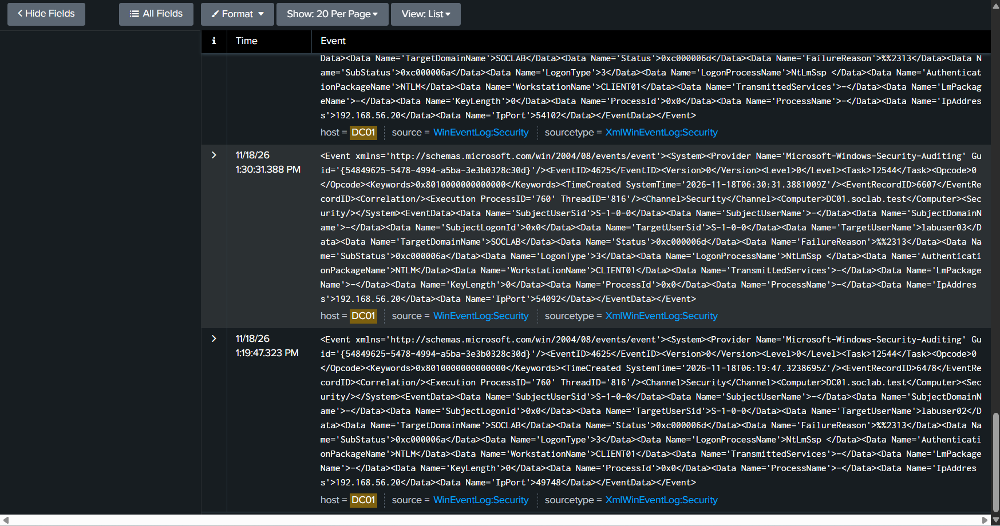

# Scenario 01: Failed Authentication Investigation

## Objective

Generate a failed network authentication attempt and verify the
event collection path from DC01 to Splunk.

## Prerequisites

- CLIENT01 is joined to the soclab.test domain.
- The labuser02 account is enabled and not locked out.
- The account lockout policy has been reviewed.
- Failure auditing is enabled for Logon and Credential Validation on DC01.
- Splunk Universal Forwarder collects the Security log from DC01.
- Splunk Enterprise is receiving the forwarded events.

## Procedure

### 1. Check Existing SMB Connections

Run the following command on CLIENT01:

```powershell
net use
```

Disconnect existing connections to DC01, if necessary, before
attempting authentication with different credentials.

### 2. Record the Start Time

```powershell
Get-Date -Format o
```

### 3. Generate a Failed Authentication Attempt

```powershell
net use \\192.168.56.10\IPC$ * /user:SOCLAB\labuser02 /persistent:no
```

Enter an intentionally incorrect password when prompted.

The `/user` parameter specifies the account used for the network
connection. This account may differ from the user currently
signed in to Windows.

### 4. Observe the Client Response

The command returned:

```text
System error 1326 has occurred.
The user name or password is incorrect.
```

This client message alone does not distinguish an incorrect
username from an incorrect password. The server-side event
provides additional detail.

## Observed Evidence

A corresponding event was found in the Security log on DC01
and in Splunk.

| Field | Observed Value |
|---|---|
| Event ID | 4625 |
| Target account | labuser02 |
| Account domain | SOCLAB |
| Workstation name | CLIENT01 |
| Logon Type | 3 |
| Status | 0xC000006D |
| SubStatus | 0xC000006A |

## Analysis

- Event 4625 records a failed logon attempt.
- Logon Type 3 identifies a network logon.
- Status 0xC000006D indicates an authentication failure.
- SubStatus 0xC000006A identifies an incorrect password.
- The target account is the account supplied to the connection,
  rather than necessarily the user signed in to the workstation.

## Investigation Query

See [failed-logon.spl](../detections/failed-logon.spl).

Select a search time range that includes the recorded test time.
Correlate the account, source information, and timestamp before
associating an event with the test.

## Result

The authentication attempt was rejected, recorded on DC01,
and successfully forwarded to Splunk.

This validates the collection path for this event. It does not
establish that a single failed attempt represents an attack.

## Troubleshooting Lesson

An initial search used the workstation's signed-in account,
labuser03, instead of the account explicitly supplied to
`net use`, labuser02.

Searching for the correct target account located the relevant event.

## Screenshots

### Client-Side Authentication Failure



### Event 4625 in Splunk


