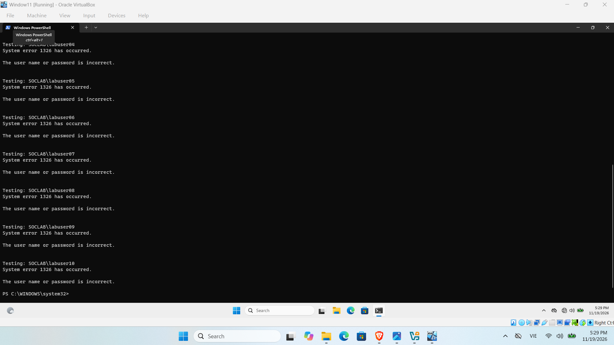
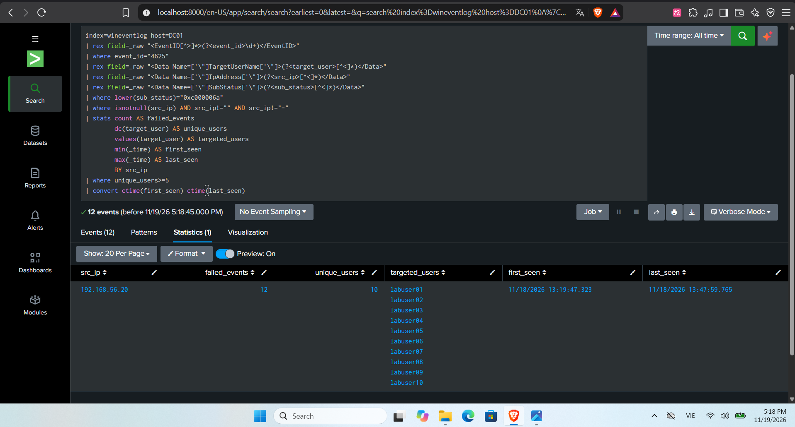

# Scenario 02: Password Spraying Detection

## Objective

Simulate password spraying against test accounts and detect
multiple accounts experiencing failed authentication from
the same source IP address.

## Lab Context

- Source: CLIENT01 — 192.168.56.20
- Destination: DC01 — 192.168.56.10
- Domain: soclab.test
- Test accounts: labuser01 through labuser10
- Data source: Windows Security log on DC01
- Analysis platform: Splunk Enterprise

### Prerequisites

- Test accounts are enabled and not locked out.
- Applicable account lockout policies have been reviewed.
- Failure auditing is enabled.
- Security events are forwarded from DC01 to Splunk.
- Existing SMB connections to DC01 have been checked.

## Investigation Method

### Lab activity

The simulation attempted authentication to the IPC$ share on DC01
using the same intentionally incorrect password across ten lab accounts.

The PowerShell script made one connection attempt per account, with a
three-second delay between attempts. It stopped if a connection
unexpectedly succeeded.

Script: [simulate-password-spraying.ps1](../scripts/simulate-password-spraying.ps1)

### Fields reviewed

Windows Security event 4625 was used to investigate the failures.

Relevant fields:

| Field | Purpose |
|---|---|
| TargetUserName | Account used in the authentication attempt |
| IpAddress | Source IP address |
| LogonType | Type of logon attempted |
| Status | General failure status |
| SubStatus | Additional failure information |

### SPL detection logic

Within the selected search time range:

1. Select event 4625.
2. Extract the target account, source IP, and SubStatus.
3. Keep incorrect-password failures with a usable source IP.
4. Group events by source IP.
5. Count distinct target accounts.
6. Return sources associated with at least five distinct accounts.

Query: [password-spraying.spl](../detections/password-spraying.spl)

The time range is part of the detection configuration.
This query aggregates over the entire selected range.

## Results

| Item | Observed Result |
|---|---|
| Test date and time zone | 2026-11-18 - UTC + 7  |
| First and last observed events in the test sequence (UTC+7) | 13:43:59.475–13:47:59.765 |
| Source IP | 192.168.56.20 |
| Failed events | 10 |
| Distinct target accounts | 10 |
| Detection threshold | 5 distinct accounts |
| Detection result | Matched the simulated activity |

### Detailed Authentication Failure Timeline

The [detailed authentication failure timeline](../evidence/password-spraying-event-details.png) shows 12 failed authentication events in a wider search window on November 18, 2026.

| Activity | Time shown in Splunk | Target accounts | Events |
|---|---|---|---|
| Earlier authentication test | 13:19:47 | labuser02 | 1 |
| Earlier authentication test | 13:30:31 | labuser03 | 1 |
| Password spraying simulation | 13:43:59–13:47:59 | labuser01–labuser10 | 10 |

All displayed events have source IP `192.168.56.20` and
SubStatus `0xC000006A`, indicating incorrect-password failures.

The total of 12 includes two earlier test events.
The spraying sequence accounts for 10 events targeting
10 distinct accounts.

These timestamps represent the observed events, rather than
the exact script start and end times.

Because the earlier tests are included in the search window,
the aggregated detection reports `first_seen` as approximately
13:19 and `failed_events` as 12.

## Interpretation and Limitations

The query identified multiple accounts with incorrect-password
failures from the same source during the test window.

This pattern is consistent with password spraying. The simulation
script establishes that the same password was used; event 4625
does not expose the attempted password.

### Limitations

- Shared source addresses may combine activity from multiple users.
- Legitimate authentication problems may produce similar patterns.
- Attempts spread across multiple sources or longer periods may
  not reach the threshold.
- This query covers event 4625 with SubStatus 0xC000006A only.
- Thresholds require tuning for the monitored environment.
- Manual detection validation does not establish that a scheduled
  alert has been configured.

## Evidence

### Simulation on CLIENT01

### Detection Results in Splunk

