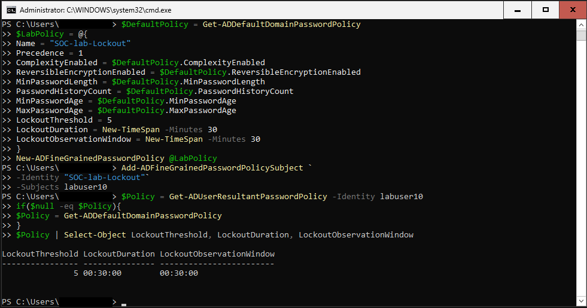
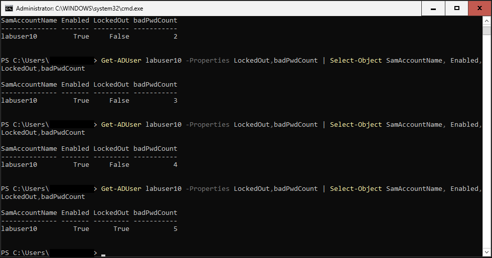
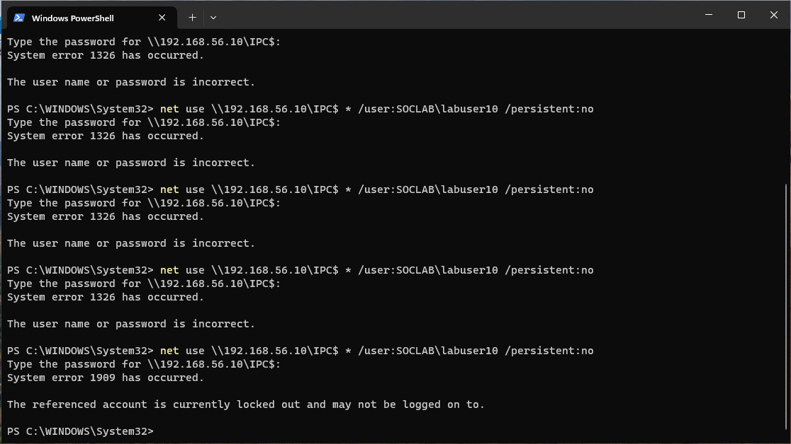
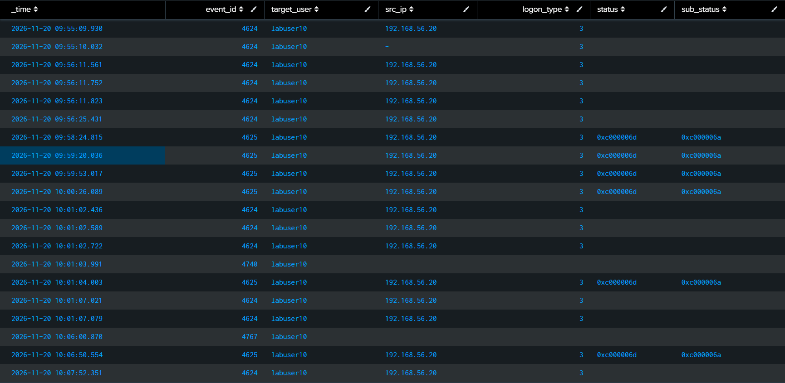
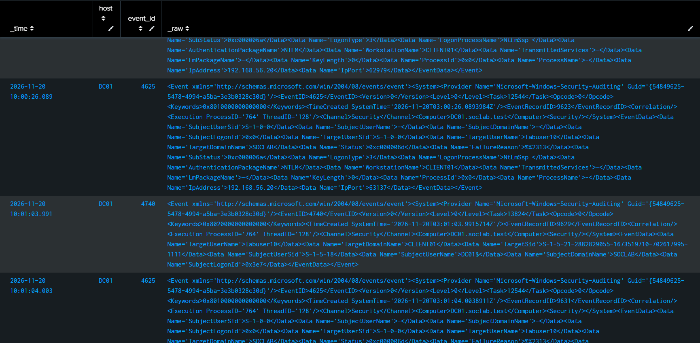
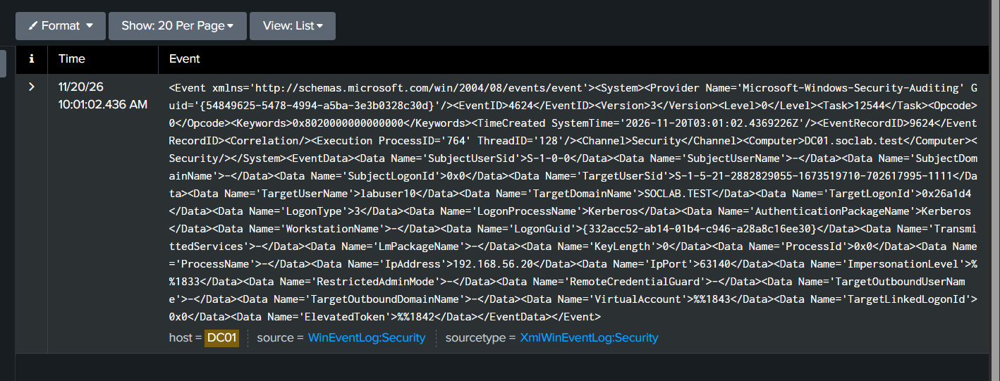

# Scenario 03 — Repeated Logon Failures and Account Lockout

This investigation correlates repeated failed network logons, an Active Directory account lockout, and successful authentication after an administrative unlock. The test account was `labuser10`, the client was `CLIENT01` (`192.168.56.20`), and Splunk collected the Windows Security log from `DC01`.

## Lockout policy and account state

The account policy specified a lockout threshold of five, a lockout duration of 30 minutes, and a 30-minute observation window.

On DC01, `LockedOut` changed to `True` when `badPwdCount` reached five.

## Client response while locked

The sixth attempt in the lab sequence returned system error `1909` on CLIENT01. The error text states that the account was locked.

## Splunk timeline

| Time on November 20, 2026 (UTC+7) | Splunk observation |
|---|---|
| `09:58:24.815`–`10:01:04.003` | Five `4625` events for `labuser10` from `192.168.56.20` with Logon Type `3` and SubStatus `0xC000006A`. |
| `10:01:03.991` | Event `4740` recorded the account lockout. |
| `10:06:00.870` | Event `4767` recorded the account unlock. |
| `10:07:52.351` | Event `4624` recorded a successful Type `3` network logon for `labuser10` from `192.168.56.20`. |

The raw `4740` record identifies `labuser10` and shows `CLIENT01` in the XML field `TargetDomainName`. Source IP attribution comes from the related network logon events.

The timeline also contains successful network logons before the lockout, including a Kerberos logon at `10:01:02.436`. The post-unlock result was correlated using the later `4624`, the `4767` event, the target account, and the source IP.

## Post-unlock validation

CLIENT01 showed a successful network connection after the administrative unlock. The client response and the later `4624` verify that the account could authenticate again. Validation used a manual Splunk search.

