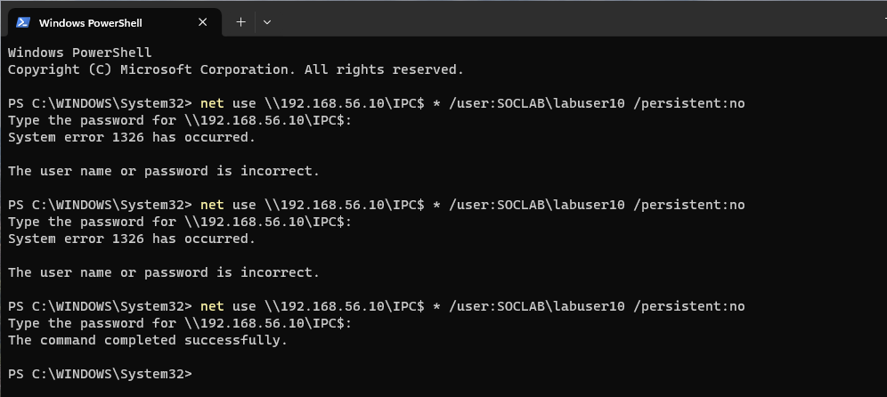

# Scenario 03: Repeated Logon Failures and Account Lockout

## Objective

Verify whether Active Directory locked `labuser10` after repeated failed network logons and whether the account could authenticate after an administrative unlock. Correlate the account state, client responses, and Windows Security events in Splunk.

## Lab Context

| Item | Value |
|---|---|
| Test account | `SOCLAB\labuser10` |
| Client | `CLIENT01` (`192.168.56.20`) |
| Log source | Windows Security log on `DC01` |
| Lockout policy | Threshold of five, 30-minute lockout duration, 30-minute observation window |
| Test date | November 20, 2026 (UTC+7) |

## Investigation Method

The timeline evidence was collected with [account-lockout-timeline.spl](../detections/account-lockout-timeline.spl). To review the same events in Splunk, run the search with an absolute time range covering **09:58 to 10:09 on November 20, 2026 (UTC+7)**. The search reads DC01's Security events for `labuser10` and sorts by event time. Change the target account in the search to investigate another lab user.

1. Review `4625` with Logon Type `3` and SubStatus `0xC000006A` for incorrect-password network logons. Check `src_ip` in the results and review the raw event for the workstation name when needed.
2. Locate `4740` and `4767` for the same account. The search retains records with no source IP so the lockout and unlock remain visible. In the separate raw event evidence for `4740`, the XML field `TargetDomainName` contains the caller computer `CLIENT01`.
3. Compare `4624` events before the lockout with those after the unlock. Use the account, timestamp, logon type, and source IP to identify the event that corresponds to the successful connection on CLIENT01.

## Results

The DC01 account state showed `LockedOut=True` when `badPwdCount` reached five. The sixth client attempt in the test returned system error `1909`, which reported that the account was locked. After the administrative unlock, CLIENT01 reported a successful connection.

### Event timeline

Selected events from the Splunk timeline follow. Times are UTC+7 on November 20, 2026.

| Time | Event ID | Observation |
|---|---|---|
| `09:58:24.815`–`10:00:26.089` | `4625` | Four incorrect-password network logon events from `192.168.56.20`. |
| `10:01:02.436` | `4624` | A successful Kerberos network logon before the account lockout. |
| `10:01:03.991` | `4740` | DC01 recorded the account lockout for `labuser10`. |
| `10:01:04.003` | `4625` | Another incorrect-password network logon record, logged 12 ms after the lockout record. |
| `10:06:00.870` | `4767` | DC01 recorded the account unlock. |
| `10:06:50.554` | `4625` | An incorrect-password network logon after the unlock. |
| `10:07:52.351` | `4624` | Successful Type `3` network logon for `labuser10` from `192.168.56.20` after the unlock. |

## Interpretation and Limitations

The account state and `4740` confirm that the lockout policy took effect. Use the client screenshot to verify the locked-account response on the sixth attempt. The number and ordering of event records need not map directly to the client commands.

Earlier `4624` events are also visible in the search. The `4624` at `10:07:52.351` follows the `4767` unlock and matches the account and source IP for the successful post-unlock test. This validates account recovery in the lab. The evidence was reviewed with a manual Splunk search. The linked SPL is the search used to collect the timeline evidence. It has no alert threshold or schedule.

## Evidence

- [Account lockout policy](../evidence/brute-force-lockout-policy.png)
- [Active Directory account state and bad-password count](../evidence/brute-force-ad-lockout-state.png)
- [Raw lockout event 4740](../evidence/brute-force-splunk-lockout-event.png)
- [Raw pre-lockout Kerberos logon event 4624](../evidence/brute-force-splunk-pre-lockout-kerberos-logon.png)
